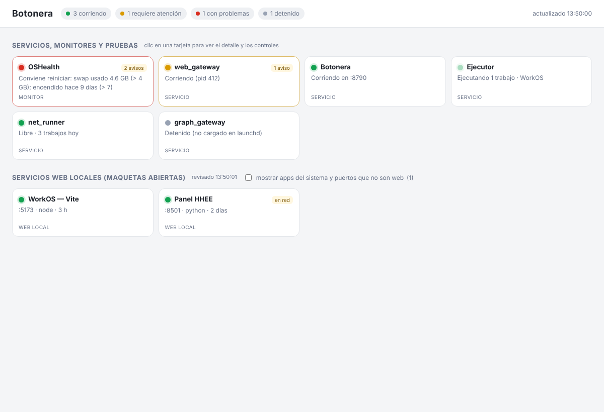

# Botonera

*[Versión en español](README.md)* — the code, UI and docs are in Spanish; this page summarizes them.

A local control panel for your Mac that shows, with a traffic-light status, **everything you have running**
— your own services, AI agents, mockups, dev servers, monitors — and gives you buttons to start, stop,
approve what asks for approval, or open its log. One standard-library Python file, one HTML page and a folder
of JSON "cards". No dependencies, no accounts, no network: it listens on `127.0.0.1` only.



It came out of a concrete need: when several AI assistants spin up services, open mockups and leave
processes running on your machine, you want one place to see what is alive, what needs your attention, and
close it with a click. Anything — hand-made or built by your AI assistant — plugs in by dropping a short JSON.

## What's inside

| Folder | What it is |
|---|---|
| `botonera/` | The panel: `botonera.py` (server), `pagina.html` (tile dashboard + detail drawer), `puertos.py` (discovers local web servers), `estados/comun.py` (helper for launchd services) and `estados/ejemplo_launchd.py` (template) |
| `mac_health/` | Optional Mac health monitor: every hour it measures memory, swap, pressure, uptime, disk and local servers; recommends a reboot and, with one button, runs the pre-reboot cleanup so the machine comes back fresh |
| `fichas-ejemplo/` | Three reference cards: plain port, launchd service, own CLI with approvals |
| `docs/CONTRATO.md` | The card/tile contract (what anyone plugging something in needs to know) |
| `docs/CONECTAR.md` | Recipes to connect your own solutions |
| `docs/PROMPT-IA.md` | Ready-made prompt so your AI assistant connects something, or rebuilds the panel on your stack |
| `docs/SIN-CODIGO.md` | For non-programmers: a two-line prompt and what to expect (Spanish) |
| `docs/INSTALAR-IA.md` | Instructions written for the AI assistant: how to install it or guide the person (Spanish) |

## Install

Requires macOS and Python 3.9+ (comes with the Xcode command-line tools, or `brew install python`).

```bash
git clone https://github.com/pashekiso/botonera.git   # or Code → Download ZIP
cd botonera
bash instalar.command               # panel + OSHealth (Mac health monitor)
bash instalar.command --sin-salud   # panel only
```

When it finishes, the panel is already running at `http://127.0.0.1:8790/` as a **user service** (launchd,
`local.botonera`): it starts by itself at login, with no windows, logging to `~/dev/botonera/var/botonera.log`.
If you ever stop it, double-click `iniciar_botonera.command` to bring it back. To run it in a Terminal and
watch its output instead: `python3 ~/dev/botonera/botonera.py servir --abrir`.

## How it works

1. The panel reads cards (`*.json` with `"esquema": "botonera-servicio/1"`) from `~/dev/botonera/servicios/`.
2. Each card names the command that produces its **tile** (status color, title, subtitle, data rows, warnings)
   and its **actions** (one command each). Everything runs without a shell and with a timeout.
3. The page renders a grid of compact tiles; clicking one opens a side drawer with details and buttons.
4. Independently of cards, it lists every **local web server** (anything listening on a port of your user that
   answers HTTP), with page title, process, folder and a Stop button.
5. If a card declares a **pending approvals** queue (e.g. an agent asking permission to run a script), it shows
   at the top, with high-risk items in red requiring you to type APROBAR.

## Connect your own thing

Minimum: a JSON like this in `~/dev/botonera/servicios/`:

```json
{
  "esquema": "botonera-servicio/1",
  "id": "my_service",
  "nombre": "My service",
  "tipo": "servicio",
  "tarjeta": {"cmd": ["/usr/bin/python3", "/path/status.py"], "cada_segundos": 10},
  "acciones": {
    "iniciar": {"cmd": ["/path/start.sh"]},
    "detener": {"cmd": ["/path/stop.sh"], "confirmar": true}
  }
}
```

where `/path/status.py` prints `{"tarjeta": {"semaforo": "verde", "titulo": "My service", "subtitulo": "Running", "datos": [], "atencion": []}}`.
Status values: `verde` (running) · `amarillo` (needs attention) · `rojo` (problem) · `gris` (stopped).
Full contract in [docs/CONTRATO.md](docs/CONTRATO.md); recipes in [docs/CONECTAR.md](docs/CONECTAR.md).

## Security

- `127.0.0.1` only; other `Host` headers are rejected.
- A per-start token embedded in the page: a web page open in another tab cannot press your buttons.
- Runs only the commands declared in cards, without a shell, validating substituted values.
- The cards folder defines what gets executed: **do not share it** with AI agents or other users. To let an
  agent see the state, have your services write a read-only copy somewhere else (as `mac_health` does).

## Known limitations

- macOS only (`launchctl`, `lsof`, `osascript`). Porting to Linux means replacing `comun.py` (systemd) and the
  cleanup steps of `mac_health`.
- The `mac_health` cleanup that quits apps uses AppleScript: macOS asks for Automation permission the first
  time; emptying `~/Library/Caches` and the Trash may need Full Disk Access for Terminal.
- No authentication beyond the local token: built for one person on their own machine.

## License

MIT. Made by [Gerardo Oyarce](https://github.com/pashekiso) with help from Claude.
