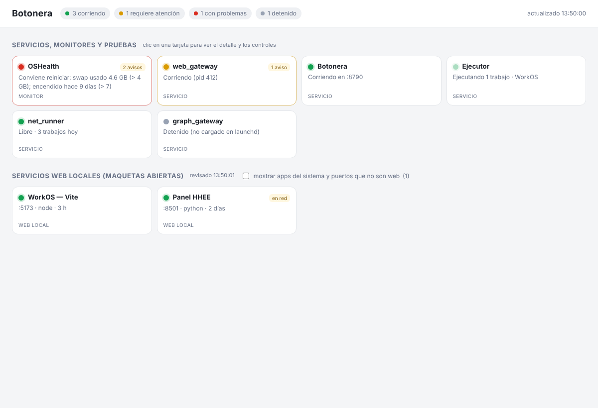
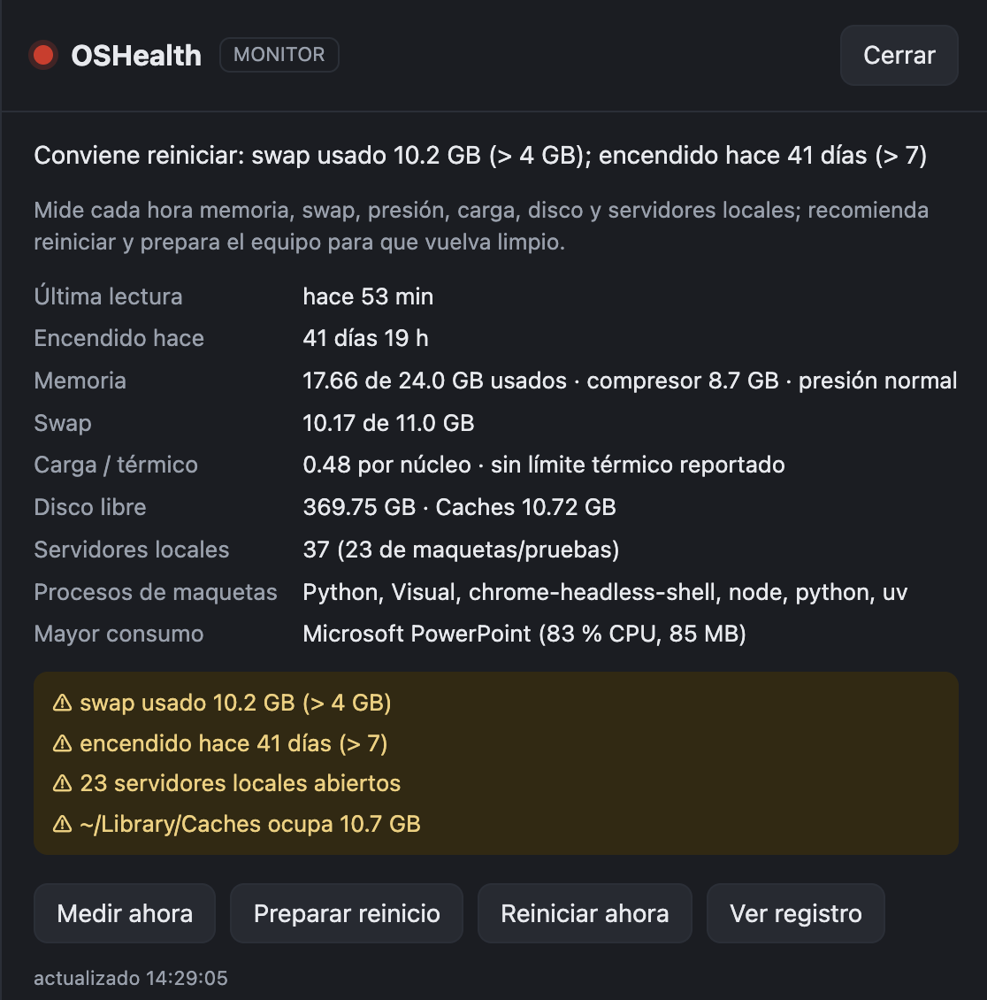

# Botonera

*[English version](README.en.md)*

Un panel local para tu computador (macOS, y Windows en beta) que muestra, con semáforo, **todo lo que tienes corriendo** —servicios propios,
agentes de IA, maquetas, servidores de desarrollo, monitores— y te da botones para iniciarlo, detenerlo,
aprobar lo que pida aprobación o revisar su registro. Un archivo de Python con biblioteca estándar, una página
HTML y una carpeta de fichas JSON. Sin dependencias, sin cuentas, sin red: escucha solo en `127.0.0.1`.





Nació de una necesidad concreta: al trabajar con varios asistentes de IA que levantan servicios, abren maquetas
y dejan procesos corriendo en la máquina, hacía falta un solo lugar donde ver qué está vivo, qué requiere
atención y cerrarlo con un clic. Cualquier solución —hecha a mano o por tu asistente de IA— se conecta dejando
un JSON de pocas líneas.

## Qué incluye

| Carpeta | Qué es |
|---|---|
| `botonera/` | El panel: `botonera.py` (servidor), `pagina.html` (mosaico + detalle), `puertos.py` (descubre servidores web locales), `estados/comun.py` (ayudante para servicios bajo launchd) y `estados/ejemplo_launchd.py` (plantilla) |
| `win_health/` | Lo mismo para Windows (**beta, sin probar en Windows real**): archivo de paginación, `%TEMP%`, Papelera de reciclaje, Docker Desktop/WSL ([detalle](win_health/LEEME.md)) |
| `mac_health/` | Monitor opcional de salud del Mac: mide cada hora memoria, swap, presión, uptime, disco y servidores locales; recomienda reiniciar y, con un botón, prepara el equipo para que el reinicio lo deje limpio ([detalle](mac_health/LEEME.md)) |
| `fichas-ejemplo/` | Tres fichas de referencia: puerto simple, servicio launchd (macOS), CLI propia con aprobaciones |
| `docs/CONTRATO.md` | El contrato de ficha y tarjeta (lo que necesita saber quien conecte algo) |
| `docs/CONECTAR.md` | Recetas para sumar tus propias soluciones |
| `docs/PROMPT-IA.md` | Prompt listo para que tu asistente de IA conecte algo, o replique el panel en tu stack |
| `docs/SIN-CODIGO.md` | Para quien no programa: un prompt de dos líneas y qué esperar |
| `docs/INSTALAR-IA.md` | Instrucciones escritas para el asistente de IA: cómo instalarla o guiar a la persona |

## Instalar

¿No programas? Pásale [docs/SIN-CODIGO.md](docs/SIN-CODIGO.md) a tu asistente de IA.

### macOS

Requisitos: macOS, Python 3.9+ (viene con las herramientas de Xcode; o `brew install python`).

```bash
git clone https://github.com/pashekiso/botonera.git   # o descarga el zip: Code → Download ZIP
cd botonera
bash instalar.command               # panel + OSHealth (monitor de salud del Mac)
bash instalar.command --sin-salud   # solo el panel
```

Al terminar, la Botonera ya está corriendo en `http://127.0.0.1:8790/` como **servicio de usuario** (launchd,
`local.botonera`): arranca sola al iniciar sesión, sin ventanas, y su registro queda en
`~/dev/botonera/var/botonera.log`. Si alguna vez la detienes, `iniciar_botonera.command` (doble clic) la
vuelve a levantar y abre el navegador. `instalar.command` se puede repetir para actualizar: conserva
`config.json` y tus fichas. Para correrla en una Terminal y ver su salida en vivo:
`python3 ~/dev/botonera/botonera.py servir --abrir`.

### Windows (beta)

Requisitos: Windows 10/11. Si no hay Python 3.9+, el instalador lo instala con `winget` solo para tu usuario.

```powershell
# descarga el zip (Code → Download ZIP), descomprímelo y haz doble clic en instalar.cmd, o en PowerShell:
powershell -ExecutionPolicy Bypass -File .\instalar.ps1          # panel + OSHealth
powershell -ExecutionPolicy Bypass -File .\instalar.ps1 --sin-salud
```

Queda corriendo sin ventana, con inicio automático en la carpeta Inicio de tu usuario (`Botonera.vbs`), y OSHealth
como tarea programada horaria (`OSHealth`). Registro en `%USERPROFILE%\dev\botonera\var\botonera.log`. Nada requiere
administrador. **Estado: beta** — el código de Windows se escribió sin un equipo Windows para probarlo; las
partes portables (servidor, página, lógica de semáforo, parsers) están probadas, la integración con `schtasks`,
`netstat` y PowerShell no. Los problemas van en los issues del repo.

## Cómo funciona

1. La Botonera lee las fichas (`*.json` con `"esquema": "botonera-servicio/1"`) de la carpeta `servicios/` de su
   instalación (`~/dev/botonera/servicios/` en Mac, `%USERPROFILE%\dev\botonera\servicios\` en Windows).
2. Cada ficha dice con qué comando se obtiene su **tarjeta** (semáforo, título, subtítulo, datos, avisos) y qué
   **acciones** existen (cada una, un comando). Todo se ejecuta sin shell, con tiempo máximo.
3. La página pinta un mosaico de tarjetas compactas; al hacer clic se abre el detalle con los botones.
4. Aparte de las fichas, lista por sí sola los **servidores web locales** (cualquier cosa que escuche en un puerto
   de tu usuario y responda HTTP), con título, proceso, carpeta y botón Detener.
5. Si una ficha declara una cola de **aprobaciones pendientes** (por ejemplo, un agente que pide permiso para
   ejecutar un script), aparece arriba, con el riesgo en rojo cuando corresponde.

## Conectar tu solución

Lo mínimo es un JSON así en la carpeta `servicios/` (rutas absolutas de tu equipo; en Windows, `C:\\...` con doble barra):

```json
{
  "esquema": "botonera-servicio/1",
  "id": "mi_servicio",
  "nombre": "Mi servicio",
  "tipo": "servicio",
  "tarjeta": {"cmd": ["/usr/bin/python3", "/ruta/estado.py"], "cada_segundos": 10},
  "acciones": {
    "iniciar": {"cmd": ["/ruta/iniciar.sh"]},
    "detener": {"cmd": ["/ruta/detener.sh"], "confirmar": true}
  }
}
```

y que `/ruta/estado.py` imprima `{"tarjeta": {"semaforo": "verde", "titulo": "Mi servicio", "subtitulo": "Corriendo", "datos": [], "atencion": []}}`.
Recetas completas en [docs/CONECTAR.md](docs/CONECTAR.md); contrato en [docs/CONTRATO.md](docs/CONTRATO.md).
Si trabajas con un asistente de IA, [docs/PROMPT-IA.md](docs/PROMPT-IA.md) le explica todo.

## Seguridad

- Solo `127.0.0.1`; rechaza peticiones con otro `Host`.
- Token por arranque embebido en la página: una web abierta en otra pestaña no puede pulsar tus botones.
- Ejecuta solo los comandos declarados en las fichas, sin shell, con validación de los valores que reemplaza.
- La carpeta de fichas define qué se ejecuta: **no la compartas** con agentes de IA ni con otros usuarios.
  Para que un agente vea el estado, haz que tus servicios dejen una copia de solo lectura en otra carpeta
  (así lo hace `mac_health`).

## Limitaciones conocidas

- macOS y Windows (beta). Linux pediría reemplazar `comun.py` (systemd), `puertos.py` (`ss`) y un `linux_health`.
- En Windows la receta "servicio bajo launchd" de `docs/CONECTAR.md` no aplica; usa la receta de CLI propia o la de puerto.
- En macOS, la mantención de OSHealth que cierra apps usa AppleScript: la primera vez macOS pide permiso de
  Automatización; vaciar `~/Library/Caches` y la Papelera puede pedir Acceso total al disco para Terminal.
- En Windows, OSHealth cierra apps con `CloseMainWindow` (las que tengan documentos sin guardar quedan abiertas y
  se listan) y apaga Docker Desktop/WSL; el reinicio no se fuerza.
- No hay autenticación más allá del token local: está pensada para una sola persona en su propio equipo.
- Desinstalar: `python3 ~/dev/botonera/botonera.py servicio desinstalar`, `python3 ~/dev/mac_health/mac_health.py desinstalar`
  y borrar `~/dev/botonera` y `~/dev/mac_health`.
  En Windows: `python %USERPROFILE%\dev\botonera\botonera.py servicio desinstalar`, `python %USERPROFILE%\dev\win_health\win_health.py desinstalar`
  y borrar esas dos carpetas.

## Licencia

MIT. Hecha por [Gerardo Oyarce](https://github.com/pashekiso) con ayuda de Claude.
